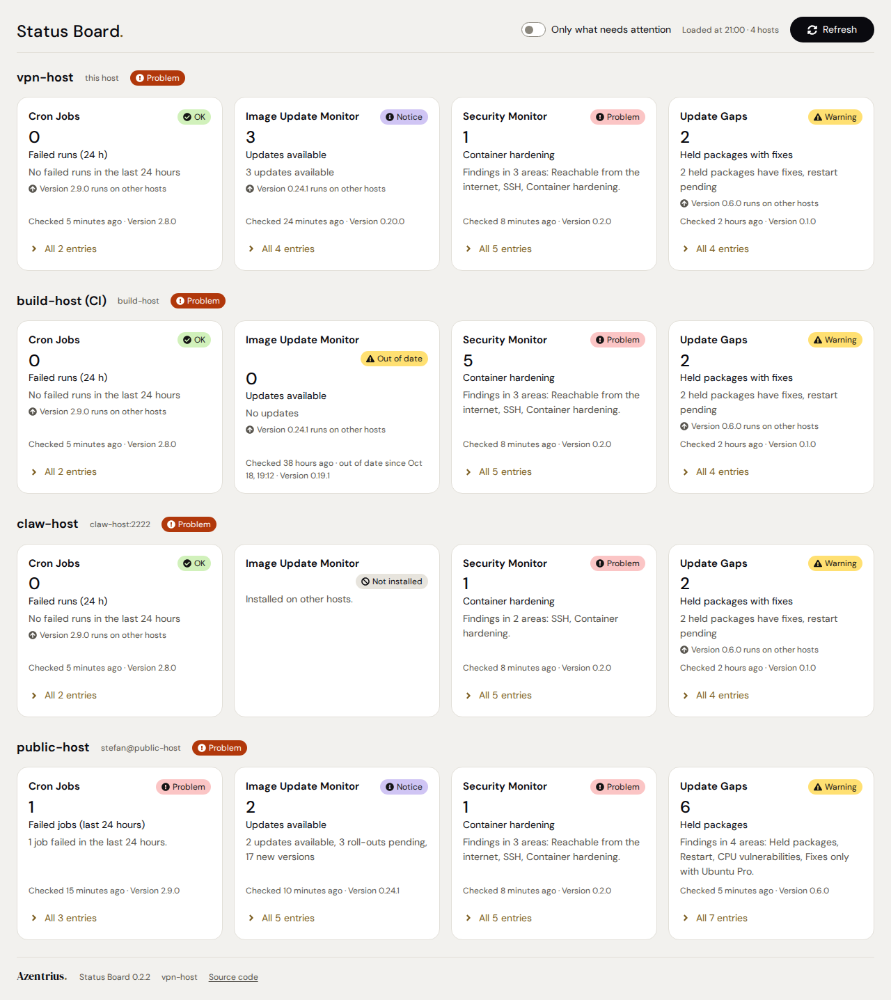
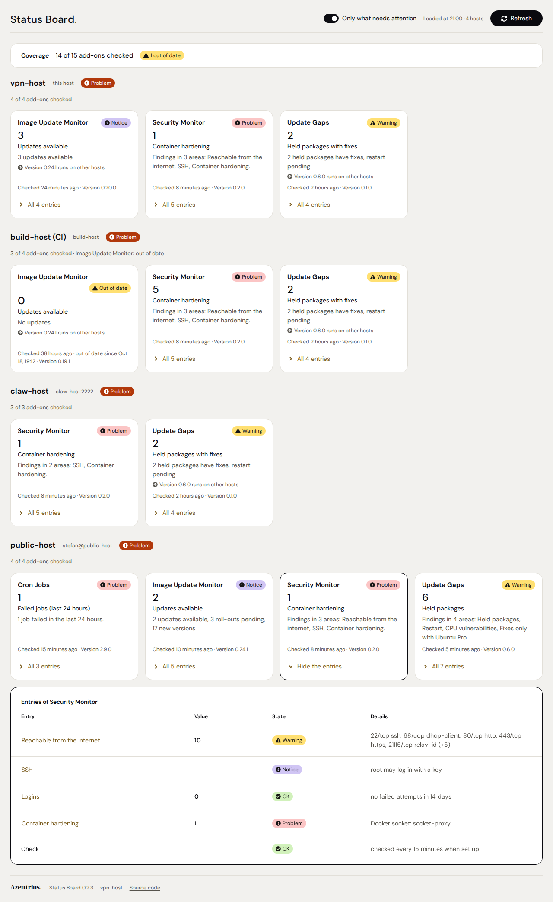
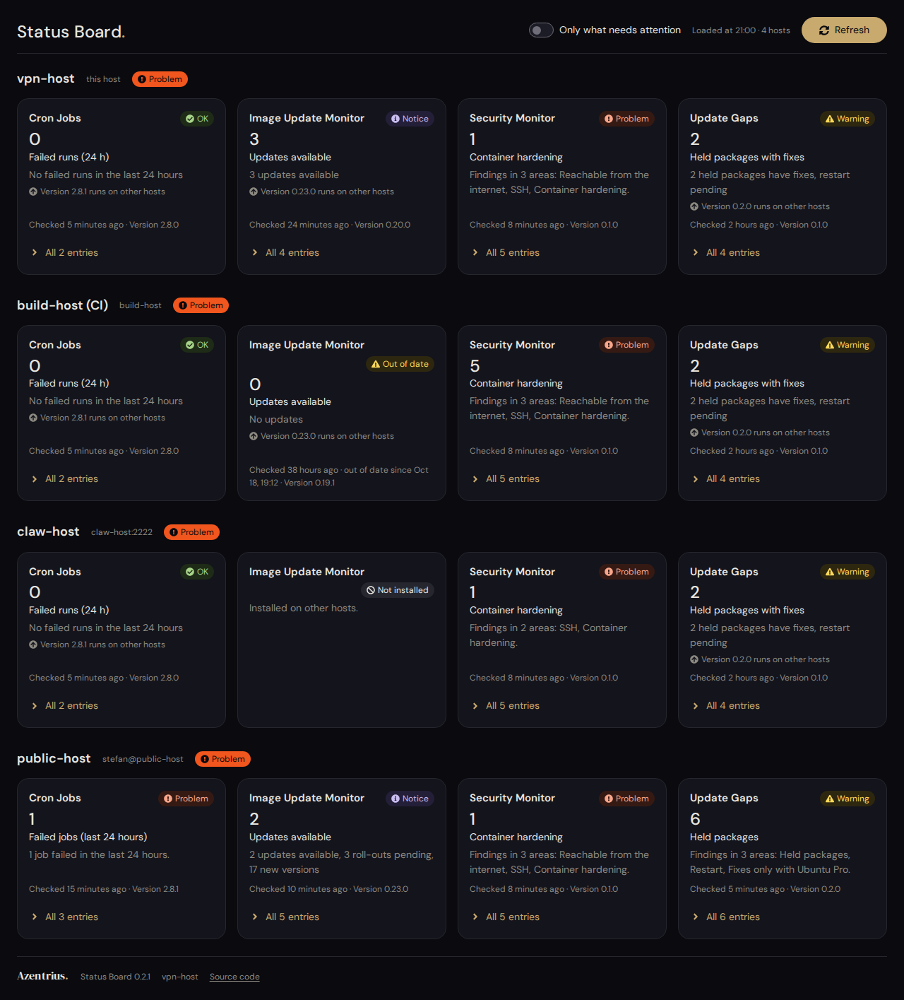
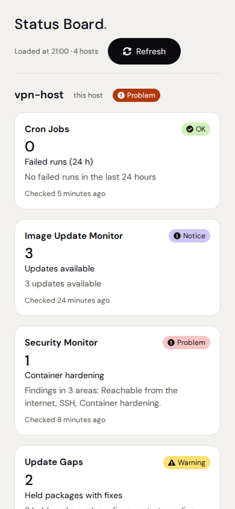

# Status Board

A [Cockpit](https://cockpit-project.org) page with the state of the Azentrius add-ons on every host
of Cockpit's host switcher: one row per host, one tile per add-on, such as
[Cron Jobs](https://github.com/Azentrius/cockpit-cronjobs),
[Image Update Monitor](https://github.com/Azentrius/cockpit-image-update-monitor),
[Update Gaps](https://github.com/Azentrius/cockpit-update-gaps) and
[Security Monitor](https://github.com/Azentrius/cockpit-security-monitor).
It belongs on the Cockpit host from which the others are reached.

Status Board only reads. It runs each add-on's `status` verb, asks for no administrative access
and changes nothing on any host; a click on a tile opens the add-on on its host.



## What it shows

- **One row per host,** in the order of the host switcher, this host first. The row's header names
  the host, the connection when it differs (`stefan@public-host`, `claw-host:2222`) and the most
  severe state of its add-ons, or why the host cannot be read ("Unreachable", "Key locked").
- **One tile per add-on:** its state in the status language (OK, Notice, Warning, Problem, Unknown),
  its most important figure with its title below it ("3" over "Updates available"), its summary
  and the age of its data. The
  tiles stand in the same order on every host, so gaps show: an add-on that runs on one host but
  is missing on another gets a neutral tile "Not installed" there.
- **What cannot be read says so:** a host that does not answer ("Unreachable", with Cockpit's
  reason), a locked SSH key ("Key locked"), an add-on without administrative access ("No access"),
  in a version without the status contract ("No status") or with an answer the board cannot use
  ("Status unreadable", with the reason). Data older than the add-on allows (`stale_after`) makes
  the tile a warning, "out of date since …".
- **Every entry of a tile:** "All 5 entries" folds out what the add-on reports, each entry with its
  label, value and detail; an entry with a place in the add-on opens it on a click (the Security
  Monitor's SSH, for example), not only the key figure's.
- **Only what needs attention:** a switch in the header leaves out the tiles in OK, Unknown, Not
  installed, No status and No access. The browser keeps the choice.
- **Versions:** each tile names the add-on's version and says so when another host runs a newer
  one ("Version 0.2.0 runs on other hosts"), so a forgotten update shows.
- **Current without you:** it loads on opening, on Refresh and every 5 minutes while the page is
  visible.

A tile in OK means that the add-on found nothing in what it checks, not that the host is safe.



|  |  |
|---|---|

The screenshots come from the browser tests (`test/ui_test.py`, scenario `real`): the answers the
add-ons give on their own test data, kept as the artifact `screenshots` of each test run.

## How it works

The hosts come from the host switcher's own list (the bridge's `cockpit.Machines`, read from
`/etc/cockpit/machines.d/*.json`). For each host the board opens a channel with the switcher's
connection string, so it uses the switcher's SSH connection, finds the add-ons by the section
`azentrius.status` in their `manifest.json`, and runs `COMMAND status --lang en|de` with
`superuser: "try"`. Everything a host sends is checked against the status contract and shown as
plain text. [docs/STATUS-CONTRACT.md](docs/STATUS-CONTRACT.md) is the contract itself, for authors
of add-ons; [docs/INTERNALS.md](docs/INTERNALS.md) has the details and every call the page makes.

## Requirements

- On the host with the board: Cockpit with the host switcher; developed against Cockpit 360. To
  read the other hosts the board does not need `AllowMultiHost`: it reaches them through the
  bridge. To open an add-on on another host with a click, the shell does need it: without it the
  shell opens every page on this host, so the tiles of other hosts open nothing then, and the
  board says why.
- On the other hosts: `cockpit-bridge`, a login by SSH key (the key unlocked in the agent, as
  `pam_ssh_add` does it at login, and the host key known), and the add-ons in a version with the
  status contract.
- Without administrative access on a host, each add-on reports what it can read without root (its
  `status.json`); that is the normal case for hosts reached with a key.

## Installation

**From the Azentrius package repository** (Debian, Ubuntu, Fedora, RHEL; set up once, see
[packages.azentrius.com](https://packages.azentrius.com)), on the host with the host switcher:

```sh
sudo apt update && sudo apt install cockpit-status-board   # Debian, Ubuntu
sudo dnf install cockpit-status-board                      # Fedora, RHEL
```

Or install **Status Board** in Cockpit under **Applications**.

**From the files of a release.** Every
[release](https://github.com/Azentrius/cockpit-status-board/releases) has the `.deb` and the
`.rpm`, `SHA256SUMS` and a signed build provenance. Download the package and `SHA256SUMS` into
one folder, check both, then install (`X.Y.Z` is the version):

```sh
sha256sum --ignore-missing -c SHA256SUMS                             # complete and unchanged
gh attestation verify <file> --repo Azentrius/cockpit-status-board   # built by this repository's release workflow

sudo apt install ./cockpit-status-board_X.Y.Z-1_all.deb      # Debian, Ubuntu
sudo dnf install ./cockpit-status-board-X.Y.Z-1.noarch.rpm   # Fedora, RHEL
```

The tests install the `.deb` on Debian 13 and the `.rpm` on Fedora 43. On other systems the
archive `cockpit-status-board-X.Y.Z.tar.gz` holds the page:
`sudo tar -xzf cockpit-status-board-X.Y.Z.tar.gz -C /usr/share/cockpit`.

**From the source.** `git clone` this repository, then `sudo make install` (to
`/usr/local/share/cockpit/status-board`); `make devel-install` links `src` to
`~/.local/share/cockpit/status-board` for development.

**Status Board** appears in Cockpit's menu near Overview; if it does not show yet, log in to
Cockpit again.

## Trying it on the bastion

The parts that reach other hosts are written from Cockpit's code; the end-to-end test (see
Development) checks them against a real Cockpit, with SSH to the test machine itself. Real hosts,
`pam_ssh_add` and the switcher's own connections show only on the bastion. On the host with the
host switcher, check once (all seven passed on a bastion with three hosts on 2026-10-20; see
[docs/INTERNALS.md](docs/INTERNALS.md#tested-on-a-bastion)):

1. The rows are the hosts of the switcher, in its order, with the same names (the switcher names a
   host by its address until it has connected to it).
2. For a host with the add-ons: the tiles appear, and on the bastion `pgrep -af "ssh.*HOST"` lists
   one connection to it after the host was also opened in the switcher (the board shares the
   switcher's connection). Each connection is two `ssh` processes: the master
   `ssh -M -N -S SOCKET … -- HOST`, which the pattern finds, and `ssh -S SOCKET cockpit-bridge`.
3. A click on a tile opens the add-on on that host, at the right tab; a click on "Unreachable"
   opens the host's Overview.
4. Without administrative access on a host: the tiles show what the add-ons report without root,
   and Cockpit asks for no password.
5. A host that is switched off shows "Unreachable" within 20 seconds; the other rows are not held
   up. Without switching a host off: a file in `/etc/cockpit/machines.d` with an address that
   never answers, such as `192.0.2.10` (the bridge reads the folder again at once; remove the
   file afterwards).
6. With the key out of the session's agent (`ssh-add -D` in Cockpit's terminal on the bastion, in
   a session in which the board has not connected yet) and an encrypted key file, the other hosts
   show "Key locked". Unlocking the key in the host switcher, or logging in to Cockpit again,
   brings it back.
7. Optionally, with `AllowMultiHost` switched off in `/etc/cockpit/cockpit.conf` (and Cockpit
   restarted): the board still reads the hosts, says that Cockpit runs without the host switcher,
   and the tiles of other hosts open nothing (the shell would open the add-on of this host).

## Safety

- Read-only: the page runs `find` with fixed arguments and each add-on's status command, and reads
  manifests and the host name. It asks for no administrative access and has no actions.
- Only commands below `/usr/lib/cockpit-` run, always with `status --lang en|de`; other arguments
  from a manifest are ignored. Manifests come with the packages and belong to root.
- What a host sends is data: every answer is checked against the contract, texts are cut and
  stripped of control and bidirectional characters and set as text only, links must stay inside
  the add-on's page, and jumps go only to plain package folders. A host can name only its own
  tiles. A compromised host can report a false state, but it cannot run code in the session.
- No JavaScript from other hosts, no files from Cockpit itself, nothing from the network: the page
  brings its own fonts and icons, and Cockpit's strict CSP stays as it is.

## Translations

Texts live in `src/i18n/`. To add a language, copy `en.js` to `<code>.js`, translate it, register it
under its code at the end of the file and add a `<script>` line to `src/index.html`. The page picks
it when Cockpit uses that language, and asks the add-ons for that language when they know it
(`--lang`, English otherwise). `node test/i18n.test.js` checks that every text exists with the
same shape.

## Development

```sh
make check        # offline tests: the status contract against good, broken and hostile answers, texts, page files, design files, version
make check-ui     # browser tests against a stand-in for Cockpit with Cockpit's CSP (needs Python Playwright with Chromium)
make lint         # shellcheck and ruff, as in CI (pip install -r test/requirements.txt)
make packages     # dist/*.deb and dist/*.rpm (needs dpkg-deb and rpmbuild), reproducible
```

`python3 test/serve.py` serves the page with the stand-in at
`http://127.0.0.1:8773/pkg/status-board/index.html` (`?scenario=real`, `hostile`, `broken` or
`empty`, `?lang=en`). The fixtures in `test/fixtures` are written for 2026-10-19 19:00 UTC; the browser
tests set their clock to it. The shared design files in `src/` are byte-identical copies from
Cron Jobs (`tools/design-files.sha256`); never change them here.

**End-to-end test.** CI runs `test/e2e_cockpit.py` as the job `e2e`, against a real Cockpit from
the Ubuntu backports on the runner's throwaway VM. Cockpit runs as the runner's user without login
(`cockpit-ws --local-session`), with an ssh-agent, and the host switcher's list
(`test/e2e/99-webui.json`) names this same machine three times, reached over an SSH server of its
own on port 2022 (`test/e2e/sshd_config`): `e2e-peer` with the key in the agent, `e2e-locked`
whose user accepts only an encrypted key that is not in the agent, and `e2e-closed` on a port
where nothing listens. A small add-on (`test/e2e/addon`) answers the status verb and says whether
it ran over SSH. The test drives Cockpit's shell with Playwright and checks what the stand-in can
only imitate: the host list from the bridge; the echo channel, `find`, the manifests, the status
verb and the host name over SSH; one SSH connection for all of it, for Refresh and for the
shell's own connection; "Key locked" and "Unreachable"; and the jumps into the add-on, on this
host and on another one (where the shell first asks to connect). The job's steps are the setup the
test expects; they change the machine, so the test runs there only. Its screenshots are kept as
the artifact `e2e-screenshots`.

## Releasing

1. Set the new version in `src/app.js` (`const VERSION`) and in every `?v=` in `src/index.html`,
   and add a section for it to `CHANGELOG.md` (`tools/check-version.sh` checks all three).
2. Merge to `main`.
3. On GitHub: Actions › **release** › Run workflow (branch `main`). The workflow checks the version,
   runs all tests, builds `cockpit-status-board-VERSION.tar.gz` and the `.deb` and `.rpm`, all
   reproducible, with `SHA256SUMS` and a signed build provenance, and creates the tag `vVERSION`
   with a release whose notes come from `CHANGELOG.md`.
4. packages.azentrius.com takes the packages from the release within an hour
   ([Azentrius/packages](https://github.com/Azentrius/packages)). The `.deb` there is the release's
   byte for byte; the `.rpm` gets the repository's own signature, so only its signature header
   differs.

## License

Status Board is licensed under the [Apache License 2.0](LICENSE); see also [NOTICE](NOTICE). The
page contains no code from Cockpit; it uses Cockpit's API `cockpit.js` at runtime, which Cockpit
itself ships.
